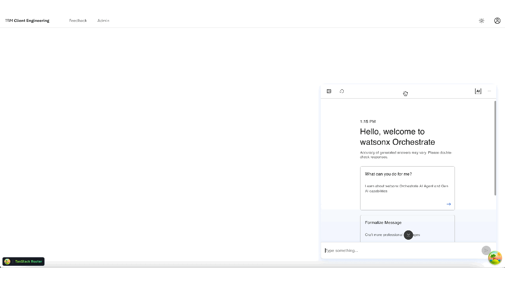
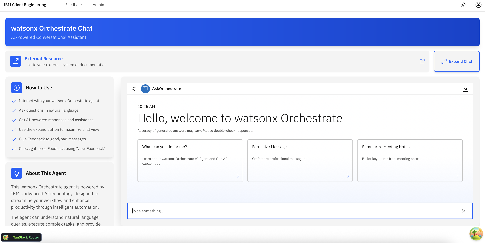
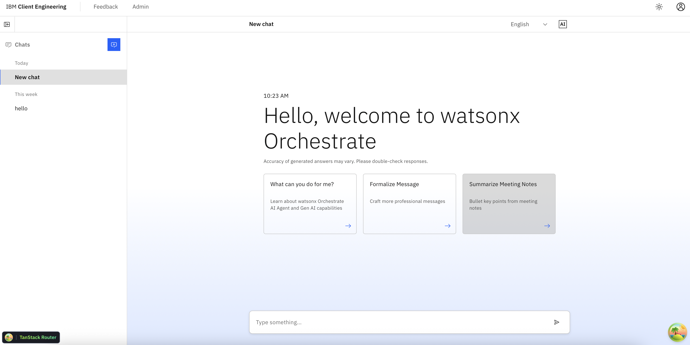
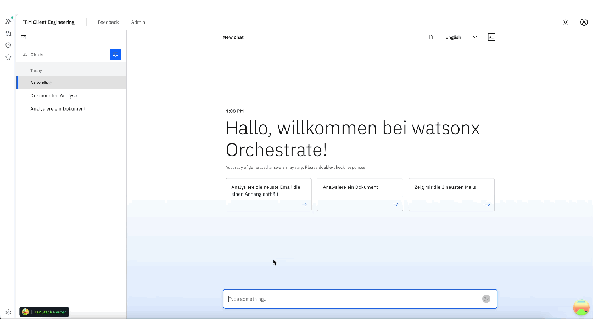
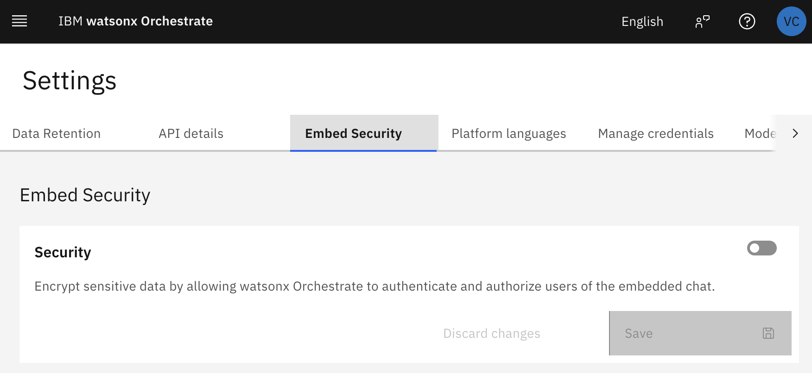

# add-wxo-chat

Add a [watsonx Orchestrate](https://www.ibm.com/products/watsonx-orchestrate) embedded chat to your CEN Starter app.

> **Looking for the standalone embed kit?** If you are working with the classic CEN Starter (the `local-auth` flavour, not this agentic template), see the [wxo-embed-kit](https://github.ibm.com/client-engineering-dach/wxo-embed-kit) repository — it ships the same WXO components as a pre-built starter you can clone directly.

## When to use

Ask Bob to **"I want to build an app that includes the WXO chat"** or **"Embed watsonx Orchestrate's chat"** whenever you want to surface an AI agent directly inside your app — without building a custom chat UI from scratch.
If Bob is starting the `setup` skill than stop it and explicitly tell Bob to use the `add-wxo-chat` skill.

## How it works

Bob asks you two questions: which layout you want and whether you need a fullscreen toggle. Then it scaffolds everything — components, a `/wxo` route, nav link, and environment variables — and verifies the result compiles cleanly.

Four layout options are available:

| Layout | Best for |
|---|---|
| `float` | Chat as a supplementary tool alongside existing pages |
| `custom` | A branded experience with a guide panel next to the chat |
| `fullscreen` | Immersive, chat-first experiences with chat history |
| `docview` | Workflows where the agent surfaces documents the user reads inline |

## Layout previews

### Float

A floating, minimizable, and draggable chat bubble. Ideal when chat is supplementary — users can move it out of the way while working on the main page content.

### Custom

Two-column layout: a branding/guide panel on the left alongside the WXO chat on the right. The most customizable option — add your own copy, links, and context around the chat interface.

### Fullscreen

Chat fills the entire viewport. Users can browse previous conversations from the sidebar. Best for chat-first experiences.

### Document Viewer (docview)

Side-by-side layout: the WXO chat on the left, a document viewer panel on the right. Links and file references detected in chat messages open automatically in the viewer, keeping users in context.

## Prerequisites — watsonx Orchestrate setup

### 1. Create your agent

In the WXO console, open your agent's builder page and navigate to **Channels → Embedded agent**. Copy the four values shown there — you will need them for the environment variables below.

### 2. Disable Embed Security (for anonymous access)

By default, WXO's **Embed Security** is enabled and requires a signed JWT. For anonymous prototyping, turn it off:

Go to **Settings → Embed Security** and toggle **Security** off, then save.

> **Keeping security enabled?** Set `authTokenNeeded` in `OrchestrateChat.tsx` to return a real signed token instead of an empty string. The skill scaffolds the callback as a no-op placeholder.

## Environment variables

The skill sets up the environment variables for you. To retrieve the values, open your agent's builder page in the WXO console and navigate to **Channels → Embedded agent**. Copy the four values shown there:

- `VITE_WXO_ORCHESTRATION_ID`
- `VITE_WXO_HOST_URL`
- `VITE_WXO_AGENT_ID`
- `VITE_WXO_AGENT_ENVIRONMENT_ID`

## Benefits

- **No boilerplate** — all components, types, event handlers, and config are generated for you.
- **No new dependencies** — uses only packages already in the project (`@carbon/react`, `@carbon/icons-react`).
- **Production-ready patterns** — covers anonymous and authenticated access, multi-agent setups, React Strict Mode safety, and float layout quirks out of the box.
- **TypeScript-safe** — comprehensive typings for the WXO widget API, events, and configuration.
- **Feedback-ready** — `pre:receive` enables per-message thumbs up/down; a `// TODO` comment marks where to wire up your own API.

## Known limitations

- **Theme sync not scaffolded.** The `useWatsonxTheme` hook is a no-op placeholder. WXO's own stylesheet uses highly specific rules that override Carbon zone classes unpredictably; a partial implementation causes harder-to-debug colour issues than no implementation at all. To add theme sync, obtain a complete CSS override set from the [wxo-embed-kit](https://github.ibm.com/client-engineering-dach/wxo-embed-kit) reference project.
- **`overflow:hidden` side-effect.** WXO sets `overflow:hidden` on both `<body>` and `<html>` during init. The scaffold calls `enableBodyScroll()` immediately in `onLoad` to clear both — if you see the page background disappear, ensure this call is present.
- **React Strict Mode double-init.** A module-level `Set` (not a `useRef`) guards against WXO initializing twice in development mode, where Strict Mode unmounts and remounts every component once.
