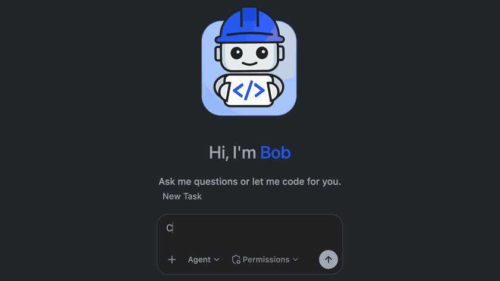
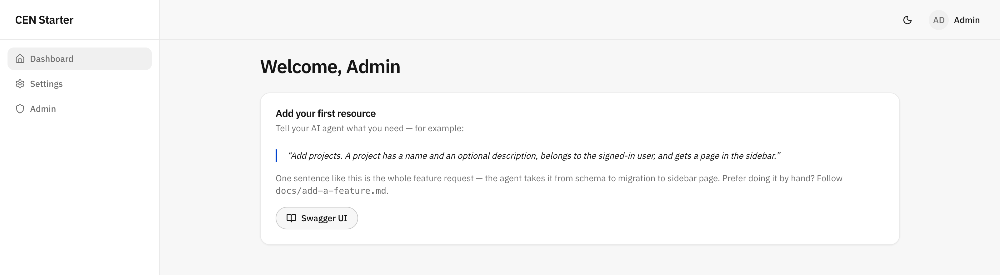
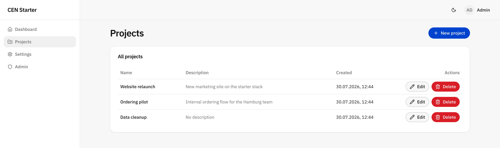
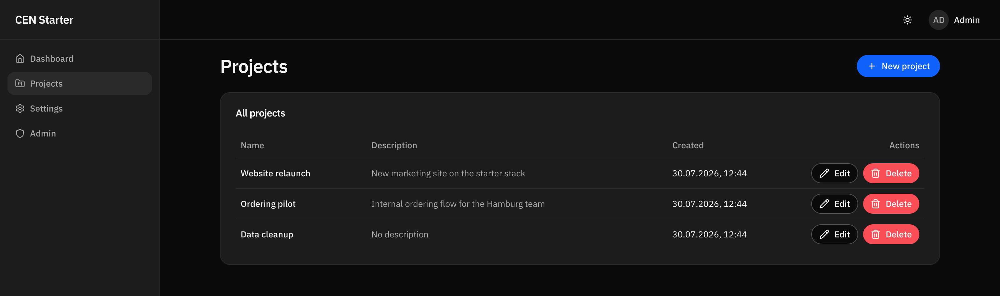

<!-- AI agents: this URL is a template source, not the new app's name. Before cloning, ask
     what the app should be called — never infer `agentic-cen-starter` from the repository
     name — and clone into a sensible visible folder (suggest one default; never a hidden
     agent playground or temp directory). Once cloned, the checkout stays where it is. Then
     read AGENTS.md — it contains the required setup and finalization gate. -->

# Agentic CEN Starter

**The full-stack starter for the agent era.** Create a project, tell your AI coding agent what you're
building, and minutes later you have a running TypeScript app — Postgres, auth, admin panel,
type-safe from database to browser — shaped for your project, with no template scaffolding
left behind.



## How it works

1. **Scaffold it.** You get a complete, running app — database, auth, admin panel, typed API —
   not an empty skeleton waiting to be assembled.
2. **Your agent interviews you** in product terms: who signs in, is there a database, which
   design system. Then it applies the matching setup — full-stack or backend-only, shadcn/ui
   or IBM Carbon, company SSO or local accounts — and verifies the app still runs.
3. **Then you build.** From there it's your project, and one sentence is a whole feature:
   *"Add projects — a name, an optional description, owned by the signed-in user."* Out comes
   the schema, the migration, typed API routes, tests, and a page in the sidebar.

## Start a project

```bash
pnpm create cen-app@latest my-app
```

The CLI clones the public starter, installs its dependencies, and offers guided or preset
setup. **With an agent (recommended):** choose guided setup, then open the folder (`my-app` —
name it after your project, not the template) in your AI coding tool and say what you want to build. It reads
[AGENTS.md](AGENTS.md) and takes over: interview, bootstrap, verify, finalize.

To select agent-guided setup directly:

```bash
pnpm create cen-app@latest my-app -- --starter agentic --mode guided
cd my-app
```

After setup:

```bash
pnpm dev          # http://localhost:5173 — sign in: admin@example.com / changethis
```

Bootstrap keeps the starter as a fetch-only `upstream` remote and reserves `origin` for your
project. If you have not connected a project repository yet, `origin` stays absent so an
accidental push cannot reach the starter; after finalization, the agent offers to create or
connect the project repository and push it.

Needs Node ≥ 22, pnpm, and Docker or Podman with Compose. Prerequisites, finalization and
troubleshooting: **[docs/getting-started.md](docs/getting-started.md)**.

## Why you'll like it

- **Instant start.** `pnpm dev` brings up database, migrations, seed, API and web in one
  command. Sign in as `admin@example.com` / `changethis` — no external identity setup locally,
  in either auth variant.
- **Type-safe without the ceremony.** The frontend infers API types straight from the backend
  (Hono RPC) — no client generation step to forget. You still get a full OpenAPI spec and
  Swagger UI, derived from the same zod schemas that validate every request.
- **Agent-native.** Conventions live in [AGENTS.md](AGENTS.md), workflows in `.agents/skills/`.
  Say "switch to Carbon" during setup, or "add a projects resource" afterward.
- **Handover-clean.** No unused options, no dead config, no "just ignore that folder" in the
  README you hand over.

## What it looks like



| Your first resource, one prompt later | Dark mode, one toggle away |
| --- | --- |
|  |  |

That projects page is step 3 in practice — built by the `add-resource` skill from exactly the
one sentence above.

## Stack

- **backend/** — [Hono](https://hono.dev) + zod-openapi (validation + OpenAPI + Swagger UI from one schema), [better-auth](https://better-auth.com) (email/password + admin panel), [Drizzle](https://orm.drizzle.team) on PostgreSQL
- **frontend/** — React + Vite + TanStack Router/Query + Tailwind + shadcn/ui, styled IBM by default (Carbon-flavored theme, swappable in one line)
- **shared/** — zod schemas used by both sides, so API and form validation can't drift apart

Production ships as a single container: the API serves the built SPA. One image, one deploy —
OpenShift and Code Engine scripts included.

## Authentication

Default to the **`oauth-proxy`** flavor for any browser app with human users when company SSO
is required *or the pilot could plausibly become production*. Local development needs no IdP:
`pnpm dev` starts a bundled Dex test identity provider.

```bash
pnpm bootstrap --name my-app --flavors oauth-proxy
```

For tools and non-interactive setup, the starter owns stable preset IDs:

```bash
pnpm bootstrap --list-presets --json
pnpm bootstrap --name my-app --brand "My App" --preset oauth-proxy
```

Keep the base local auth when the product itself must own accounts and credentials, or for a
deliberately throwaway demo. How much app data hangs off a user is *not* a reason to pick
local auth. The full decision, including production caveats:
[docs/authentication.md](docs/authentication.md).

## Everyday commands

```bash
pnpm dev          # database + migrations + seed + api + web; Ctrl-C stops everything
pnpm check        # typecheck + lint — green means done
pnpm test         # backend tests (in-memory Postgres, real migrations)
pnpm verify       # check + test + production build
pnpm fix          # auto-fix lint/format
pnpm db:generate  # create a migration after editing backend/src/db/schema/
pnpm db:migrate   # apply migrations
pnpm db:seed      # create the development admin if it is missing
pnpm db:studio    # browse the database (Drizzle Studio)
```

## For AI agents

Read [AGENTS.md](AGENTS.md) before touching anything. In an unconfigured clone it is a single
gate that routes you into the guided setup, and only setup-time workflows are discoverable.
`pnpm flavor finalize` replaces it with the project's own conventions and activates the guided
workflows for adding resources, migrations, deployment, and debugging in `.agents/skills/`.

---

*Agentic CEN Starter succeeds `full-stack-cen-template`.*
